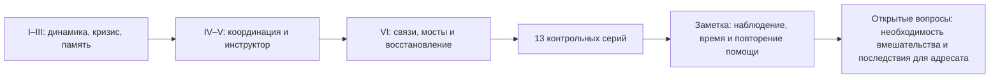

# Meta-Stable Architectures · Метастабильные архитектуры

Вычислительные исследования восстановления, памяти, координации и изменения связей. Здесь собраны ранние тексты I–III, дальнейшие рабочие материалы и проверенные экспериментальные серии. **Начать удобнее с опубликованной заметки ниже.**

## Опубликованная заметка: локальное восстановление ресурсной сети

**Локальное восстановление ресурсной сети: наблюдение, время помощи и последствия повторных вмешательств.** Опубликована на Zenodo 18 ноября 2026; сопроводительный выпуск на GitHub — `recovery-note-v1.0.1`. Текст 1.0.0, комплект 1.0.1.

**[Читать PDF](output/pdf/local-recovery-note-ru.pdf) · [Скачать готовый комплект](https://github.com/katiasmolskaia-hub/meta-stable-architectures/releases/download/recovery-note-v1.0.1/local-recovery-note-v1.0.1.zip) · [GitHub Release](https://github.com/katiasmolskaia-hub/meta-stable-architectures/releases/tag/recovery-note-v1.0.1) · [Zenodo / DOI](https://doi.org/10.5281/zenodo.24332972)**

Мы сравнивали простые правила наблюдения, время помощи и её повторение на общем вычислительном стенде. В одном выбранном после просмотра результатов случае повторная помощь увеличила накопленное потребление ресурса всей сети, но ухудшила снабжение получателя. Это отдельный случай, а не общий эффект повторной помощи. Основные сравнения, ограничения и неопределённые результаты сохранены в тексте.

| Что вам нужно | Куда перейти |
|---|---|
| Понять исследование без программирования | [Начать здесь](START_HERE.md) → [текст заметки](publication/recovery-note-2026-11-17/note.ru.md) |
| Получить только материалы этой заметки | [Самостоятельный ZIP](https://github.com/katiasmolskaia-hub/meta-stable-architectures/releases/download/recovery-note-v1.0.1/local-recovery-note-v1.0.1.zip): распаковать и открыть `START_HERE.md` внутри |
| Запустить короткий пример | [Проверка и воспроизведение](publication/recovery-note-2026-11-17/REPRODUCE.md) |
| Найти данные, протоколы и выводы 13 серий | [Исследовательский указатель](RESEARCH_STATUS.md) · [архив результатов](research_results/README.md) |
| Понять, где остановились и что остаётся открытым | [Состояние проекта](research_overview/STATE.md) · [замысел и границы](research_overview/VISION.md) |
| Правильно сослаться и узнать вклад участников | [Цитирование](publication/recovery-note-2026-11-17/CITATION.md) · [авторство](AUTHORSHIP.md) |

## Быстро попробовать

Для короткого примера достаточно Python и NumPy. Исходное расчётное окружение: Python 3.12.14, NumPy 2.3.5. Используйте отдельное виртуальное окружение.

```sh
python -m pip install numpy==2.3.5
python publication/recovery-note-2026-11-17/quick_demo.py
```

Один фиксированный мир и три правила; результат сверяется с сохранённым архивом. Один запуск не доказывает среднее преимущество. В самостоятельном ZIP тот же пример запускается через `python run_demo.py`; проверки целостности и полный порядок работы описаны внутри.

## Карта большого проекта



Подробная [карта в Markdown](START_HERE.md) читается прямо на GitHub. Для наглядной HTML-карты [скачайте репозиторий](https://github.com/katiasmolskaia-hub/meta-stable-architectures/archive/refs/heads/main.zip), распакуйте и откройте `research_overview/index.html` в браузере. Она работает без сервера; все относительные ссылки остаются внутри распакованной папки. GitHub показывает исходный HTML, а не запускает страницу.

| Папка | Содержимое |
|---|---|
| `publication/recovery-note-2026-11-17/` | Опубликованный текст, численный аудит, короткий пример, инструкции и сведения о DOI |
| `research_results/` | Проверяемый архив: CSV, конфигурации, снимки кода и графики |
| `simulations/` | Рабочие научные модули; выбирать по отчёту соответствующей серии |
| `research_overview/` | Карта, текущее состояние и открытые вопросы |
| `manuscripts/` | Ранние тексты и протоколы; номера папок не совпадают с номерами томов |
| `output/pdf/` | Опубликованный PDF заметки |

Замысел метастабильного цикла с десятью наблюдаемыми признаками остаётся исследовательской целью. Выпуск заметки не означает завершения всей архитектуры, доказанного общего превосходства, испытаний реального роя или независимой научной рецензии. Научная основа трёх серий закреплена ревизией `a4c8880e469445cb203ee157d52990b2e9b6d5bc`; поздние дополнения — текст, проверки и оформление выпуска.

## Авторство и условия использования

Полная авторская строка PDF: **SymbiosisK (Katia) & ChatGPT / Codex (OpenAI)**. Katia определяла вопросы и направление исследования и отвечает за решение о публикации. Существенный вклад Codex в анализ, код проверок, текст и комплект, а также вклад ChatGPT (Лиры) в дополнительный разбор и редакционные рекомендации раскрыты в [AUTHORSHIP.md](AUTHORSHIP.md).

Для выпущенной заметки и её комплекта: **MIT для кода; CC BY 4.0 для текста, рисунков и данных**. [Область действия и тексты лицензий](LICENSE.md). [Цитирование и DOI](https://doi.org/10.5281/zenodo.24332972).

## Ранние публикации I–III

Исторические материалы трилогии сохранены; их сильные формулировки не заменяют выводы поздних контрольных серий.

| Том | Публикация v2 | Первая версия |
|---|---|---|
| I · Foundations of Metastable Dynamics | [10.5281/zenodo.19036483](https://doi.org/10.5281/zenodo.19036483) | [10.5281/zenodo.18815179](https://doi.org/10.5281/zenodo.18815179) |
| II · Crisis Scaling and Adaptive Regime Transitions | [10.5281/zenodo.19037004](https://doi.org/10.5281/zenodo.19037004) | [10.5281/zenodo.18838477](https://doi.org/10.5281/zenodo.18838477) |
| III · Homeodynamic Memory Regulation and Stochastic Robustness | [10.5281/zenodo.19037170](https://doi.org/10.5281/zenodo.19037170) | [10.5281/zenodo.18844134](https://doi.org/10.5281/zenodo.18844134) |

## English entry point

**Local Recovery in a Resource Network: Observation, Help Timing, and Repeated Interventions.** An openly archived Russian research note with code, data, provenance and a short reproducible example. [Download the self-contained companion](https://github.com/katiasmolskaia-hub/meta-stable-architectures/releases/download/recovery-note-v1.0.1/local-recovery-note-v1.0.1.zip), extract it, and start with `START_HERE.md`. The companion README and provenance documents are in English. [DOI](https://doi.org/10.5281/zenodo.24332972) · [Release](https://github.com/katiasmolskaia-hub/meta-stable-architectures/releases/tag/recovery-note-v1.0.1). Negative and inconclusive results, numerical limitations and post-hoc example selection are explicitly disclosed.
