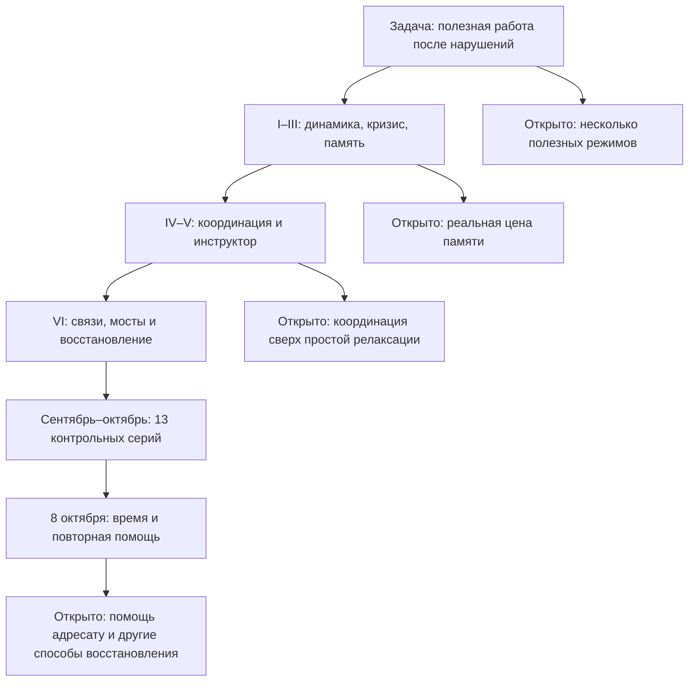

# Метастабильные архитектуры — начать здесь

Карта обновлена **19 ноября 2026**. [Отдельный GitHub Release](https://github.com/katiasmolskaia-hub/meta-stable-architectures/releases/tag/recovery-note-v1.0.1). [Заметка опубликована на Zenodo](https://doi.org/10.5281/zenodo.24332972); [сведения для цитирования](publication/recovery-note-2026-11-17/CITATION.md). Последняя найденная завершённая серия - **8 октября 2026, повторная помощь после перестройки**. Карта описывает сохранённые материалы; новых экспериментальных серий при её подготовке не запускали.

**Наш вопрос:** может ли система с небольшим вмешательством переживать нарушения, восстанавливать полезную работу и при необходимости переходить в другой подходящий режим?

**Уточнение замысла:** пользователь напомнила ориентир — оставить 10 наблюдаемых признаков и включать участие только при необходимости. Это ещё не достигнутый результат. [Замысел VI, близкие области и проверенный статус публикаций](research_overview/VISION.md).

**Текущий ответ:** отдельные простые механизмы помогают в вычислительных стендах. Дополнительная польза всей архитектуры, её научная новизна и перенос на реальные рои, LLM или квантовые устройства пока не установлены.

## Четыре входа вместо поиска по папкам

| Что хочется понять | Куда идти |
|---|---|
| Посмотреть проект целиком | [Наглядная карта](research_overview/index.html) — открыть в браузере; работает локально без интернета |
| Вспомнить остановку и следующий шаг | [Текущее состояние](research_overview/STATE.md) |
| Найти проверку и её данные | [13 серий с выводами](RESEARCH_STATUS.md) → [архив результатов](research_results/README.md) |
| Понять, что готовить к публикации | [Оценка и план материала](research_overview/PUBLISHING.md) |
| Прочитать опубликованную заметку | [Версия 1.0.0: локальное восстановление ресурсной сети](publication/recovery-note-2026-11-17/note.ru.md) · [PDF](output/pdf/local-recovery-note-ru.pdf) |
| Скачать самостоятельный комплект к заметке | [Папка готового пакета](release/local-recovery-note-v1.0.1/README.md) · [ZIP](https://github.com/katiasmolskaia-hub/meta-stable-architectures/releases/download/recovery-note-v1.0.1/local-recovery-note-v1.0.1.zip) |

## Как связаны части исследования

## Что важно сохранить в голове

- **Мост — начало цепочки, а не последняя остановка.** Далее проверяли буфер, выбор соседей, цену перестройки, локальные запросы, память, время и повторение помощи.
- **Простые контроли обязательны.** Пауза после отказа, последний контакт, обычный буфер и запрос при нехватке часто объясняют большую часть пользы.
- **Связность, хорошее среднее и восстановление каждого узла — разные вещи.** Есть отдельный случай, где помощь улучшает сеть и ухудшает положение инициатора.
- **Неподтверждённое преимущество не равно доказанному отсутствию эффекта.** Учитываем интервалы, цену, размер выборки и условия опыта.
- **Проект шире последнего стенда.** Цена памяти, выход из изоляции и другие полезные режимы остаются самостоятельными вопросами.

## Где что лежит

| Папка / файл | Назначение | Когда открывать |
|---|---|---|
| `research_overview/` | Эта карта, остановка, оценка публикации | При возвращении после паузы |
| `RESEARCH_STATUS.md` | Указатель 13 завершённых контрольных серий | Для выводов и воспроизведения |
| `research_results/` | Сохранённые CSV, конфигурации, снимки кода, графики | Для проверки результата; это основной архив |
| `manuscripts/v6/` | Протоколы, отчёты и ранние концептуальные заметки VI | Начинать с файлов `*_results_*` и карты 8 октября |
| `simulations/` | Рабочий код; здесь рядом есть и старые опыты | Найти нужный модуль через отчёт, а не запускать всё |
| `manuscripts/v2/` | Основные локальные тексты I–III и сопутствующие копии | Для оснований модели |
| `manuscripts/v3/` | Основной локальный текст IV и его рисунки | Для мягкой координации |
| `manuscripts/v4/` | Основные локальные тексты V, инструктор и материалы | Для многорежимного вмешательства |
| `experiments/thermal_noise/`, `pilot/` | Ранние проверки шума и пилот | Для истории и специальных вопросов |
| `outputs/` | Локальные расчёты, промежуточные и дублирующие варианты | Когда нужны детали происхождения; для чтения обычно хватает архива |
| `figures/`, `png/` | Ранние изображения | Через ссылки из соответствующего текста |

**Имена папок `v2/v3/v4` — история редакций, а не нумерация томов.** Например, основной текст IV находится в `v3`, а V — в `v4`. Отдельные копии IV–VI есть также в `v2`; они не назначены актуальными только по имени папки.

Ранняя [master summary VI](manuscripts/v6/volume_VI_master_working_summary.md) сохраняет первоначальную концепцию и более сильные формулировки. Для оценки доказательств сначала читать [позднюю сверку I–VI](manuscripts/v6/research_vectors_2026-10-08.md) и итоговые отчёты. В частности, ранний опыт маршрутов не заменяет сравнение со строгими простыми контролями.

## Почему папка кажется раздутой

На момент сверки `outputs/` занимает около **176 МБ / 1 041 файл**, а проверенный архив `research_results/` — около **40 МБ / 442 файла**. Это во многом разные представления одних расчётов и промежуточная история, а не полторы тысячи самостоятельных открытий. Размеры указаны без `.git` и могут меняться. Ничего из исследовательских материалов не удалено и не перемещено.

## Что делаем дальше

Ближайшая задача — вернуться к [замыслу малого наблюдаемого контура](research_overview/VISION.md): какие признаки доступны, когда участники перестают справляться сами и какое участие допустимо? Утверждённого проверенного набора из десяти наблюдаемых пока не найдено. Вопрос помощи адресату остаётся одной из конкретных проверок этого контура; варианты протокола — в [STATE.md](research_overview/STATE.md).

Для работы на GitHub: публичная исследовательская ветка — `codex/local-support-pulse`; [исследовательский указатель в этой ветке](https://github.com/katiasmolskaia-hub/meta-stable-architectures/blob/codex/local-support-pulse/RESEARCH_STATUS.md). Наличие отчётов и архива в ней подтверждено 17 ноября 2026. Карта и заметка включены в выпуск `recovery-note-v1.0.1`; главная README содержит навигацию к публикации, архиву и открытому исследованию; [подробности статуса](research_overview/VISION.md).

## Как поддерживать порядок

После завершённого опыта обновить его отчёт и `RESEARCH_STATUS.md`, затем остановку в `research_overview/STATE.md` и запись в `research_overview/project-index.json`. Пересобрать наглядную карту командой `pwsh -File research_overview/build_map.ps1` из корня репозитория (PowerShell 7). Не считать новый черновик завершённым опытом и не менять вывод только по удачному графику.
