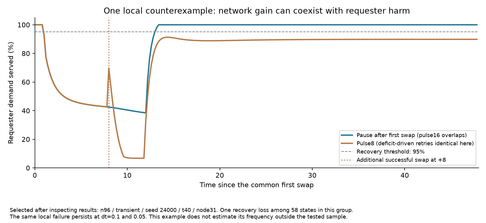

# Локальное восстановление ресурсной сети

## Наблюдение, время помощи и последствия повторных вмешательств

Исследовательская заметка. Версия 1.0.0, подготовлена 17 ноября 2026.

**SymbiosisK (Katia) & ChatGPT / Codex (OpenAI)**

При участии ChatGPT (Лира) и Codex. Описание вклада приведено в конце заметки.

<!-- pagebreak -->

### Аннотация

Рассматривается вычислительная ресурсная сеть, в которой участники могут запрашивать локальную перестройку связей при недостаточном снабжении. На материале трёх последовательных серий исследуются признаки обращения, время одной попытки и повторные вмешательства. Дополнительный признак улучшения сокращает сообщения на 16.2%, но не даёт преимущества снабжения перед простым правилом устойчивой нехватки. В выбранных состояниях немедленный вызов помощи увеличивает накопленное потребление относительно ожидания; этот контраст включает разницу в числе попыток. Дополнительные сравнения одной попытки в разные моменты поддерживают преимущество раннего вызова за общий горизонт, при возможном изменении выбранной перестройки. Общего удлинения восстановления от повторения не найдено. Постфактум выбранный иллюстративный случай показывает улучшение сетевого результата при вреде инициатору; его проверка на трёх шагах не является независимой репликацией. Результаты обосновывают раздельную оценку прогноза дефицита, доступности действия, цены и последствий для адресата. Код, данные и протоколы сохранены в открытом репозитории [D1-D4].

### Исследовательский вопрос

Как определить по доступным местным измерениям, что участнику требуется помощь, и проверить, помогло ли выбранное действие? Этот вопрос возникает при проектировании систем, в которых наблюдение и координация ограничены, а постоянное вмешательство нежелательно. Рассматриваемая модель позволяет отдельно менять правило обращения и сохранять один и тот же механизм помощи.

Заметка объединяет три серии, выполненные 8 октября 2026: минимальный наблюдатель, время одной попытки и повторную помощь. Это последовательные проверки компонентов на общем стенде. Их выбор определяется общей постановкой, включая отрицательный результат первого опыта, а не отбором только положительных эффектов.

### Контекст

Управление по событию рассматривает включение наблюдения и воздействия по необходимости; при этом отдельно обсуждаются ограничения доступности полного состояния [L1]. Адаптивные сети связывают изменение состояний участников с перестройкой топологии [L2]. Совместный выбор действий и коммуникации при ограниченном обмене также исследуется в многоагентных системах [L3]. Эти работы задают близкие классы задач. Здесь их алгоритмы не реализованы как конкуренты, поэтому сравнительное превосходство или новый общий принцип не заявляются.

Более широкая программа проекта посвящена восстановлению при ограниченном наблюдении. Данные этой заметки пока не устанавливают метастабильность, наличие нескольких полезных режимов или достаточность заранее ограниченного числа наблюдаемых признаков.

<!-- pagebreak -->

## 1. Модель и способ сравнения

### Ресурсная сеть

Сеть содержит 96 или 384 узла; четверть узлов являются источниками, остальные потребляют ресурс для выполнения заданного спроса. У каждого узла четыре активные связи и двенадцать потенциальных соседей в кольцевой геометрии. Передача ограничена запасом и пропускной способностью; учитываются потери, утечка и конечная ёмкость хранения. Расположение источников само по себе может создавать нехватку даже без внешнего повреждения.

Помощь представляет собой обмен двух связей с сохранением степени узлов. Кандидаты оцениваются по результатам фактических контактов и доступному запасу помощника. Поиск может завершиться отказом. Техническое создание связи не гарантирует будущей пользы. Цена успешной операции составляет 0.12 единицы ресурса помощника; неудачная процедура учитывается как 24 сообщения, успешная как 32. Энергия реальной связи в эти единицы не переводится.

### Динамика одного шага

Пусть `x_i` - запас перед шагом, `s_i(t)` - подача, `d_i(t)` - спрос в единицу времени, `h` - шаг, `S` - ёмкость хранения. Если перед шагом состоялась помощь, её цена уже вычтена из запаса помощника. После поступления ресурса и утечки:

`b_i = min(S, x_i + s_i*h) * exp(-lambda*h)`.

Избыток при ограничении ёмкости учитывается как переполнение. Для каждой возможной неориентированной связи `e={i,j}` донором становится узел с большим `b`. Признак активности `a_e` равен 0 или 1. Предлагаемый объём:

`w_e = g * abs(b_i-b_j) * a_e * h`.

Все исходящие передачи одного донора совместно ограничены его запасом и бюджетом `B*h`. Для `F_i`, равного сумме предлагаемых исходящих объёмов:

`alpha_i = min(1, min(b_i, B*h) / max(F_i, 1e-15))`;

`f_e = alpha_donor(e) * w_e`, получено по связи: `q_e(t)*f_e`.

Здесь `q_e(t)` - заданная средой доля доставленного ресурса. Передачи применяются одновременно, затем повторно ограничивается ёмкость и удовлетворяется спрос:

`z_i = min(S, b_i + sum_in(q_e*f_e) - sum_out(f_e))`;

`c_i = min(z_i, d_i*h)`; `x_i(next) = z_i-c_i`.

Не доставленная часть передачи учитывается как потеря. Выполненная доля спроса потребителя за шаг равна `r_i = c_i/(d_i*h)`. Источники не инициируют помощь. Следовательно, конкуренция исходящих ресурсных потоков за бюджет узла в модели есть; конкуренция сообщений в физическом канале связи не моделируется.

<!-- pagebreak -->

### Выбор перестройки

Оценка качества `qhat_e` первоначально равна 0.75 и заменяется фактически наблюдаемым `q_e(t)` только при передаче больше `1e-12`. Наблюдения идеальны, без измерительного шума. Инициатор `a` выбирает своего соседа `b` с наименьшей оценкой; равенства разрешаются генератором случайных чисел.

Кандидат `c` входит в потенциальное окружение `a`, ещё не является его соседом и имеет запас не меньше суммы резерва и цены помощи, а также строго больше `x_a + margin`. Для каждого допустимого соседа `d` узла `c` проверяются отсутствие повторных рёбер и доступность пары `b-d`. Выбирается максимум:

`score = qhat_ac + qhat_bd - qhat_ab - qhat_cd`.

Если кандидат найден, `a-b` и `c-d` заменяются на `a-c` и `b-d`, а цену платит `c`. **Положительность score не требуется.** Если кандидата нет, попытка не меняет связи. При равных оценках порядок перебора кандидатов случайный, порядок соседей фиксированный. Такой выбор не оптимизирует будущий поток именно к инициатору.

### Параметры основного стенда

| Параметр | Значение |
|---|---|
| Шаг h; размеры N | 0.2; 96 и 384 |
| Ёмкость S; начальный запас | 2.0; 0.7 |
| Проводимость g; бюджет B; утечка lambda | 0.55; 0.65; 0.003 |
| Базовая подача источника; спрос потребителя | 0.55; 0.15 |
| Хорошая / плохая доставка; начальная оценка | 0.98 / 0.20; 0.75 |
| Цена помощи; резерв помощника; margin | 0.12; 0.30; 0.10 |
| Сглаживание; окно изменения; длительность нехватки | 2; 4; 2 |
| Порог снабжения; порог улучшения; пауза запросов | 0.95; 0.02; 8 |

Источники выбираются случайно без возвращения: `N/4` узлов. Начальные подачи умножены на независимые коэффициенты 0.94..1.06, спрос - на 0.92..1.08. Исходные активные соседи находятся на расстояниях 1 и 2 в кольце, потенциальные - до 6 в каждую сторону. Маски повреждений заданы seed, доля плохих связей в их генераторе 0.35. Шаги 0.1 и 0.05 используются в отдельных численных проверках. Возмущения меняют подачу, спрос или доставку по описанному в протоколах расписанию.

<!-- pagebreak -->

### Наблюдение и действия

Наблюдатель обновляет уровень `u_i <- u_i + (1-exp(-h/2))*(r_i-u_i)` и сравнивает его со значением за 4 единицы времени до текущего момента. Счётчик нехватки растёт на h при `u_i < 0.95` и иначе обнуляется. Простое правило обращается после 2 единиц нехватки; второй вариант также требует изменения не больше 0.02 и заполненного окна истории. Пауза между запросами не меньше 8. Решение использует наблюдения до текущего шага. Ни название сценария, ни будущее контроллеру не передаются; пороги в коде сравниваются с численными допусками.

| Серия | Вмешательства и горизонт | Основная группа |
|---|---|---|
| Наблюдатель | Постоянно работающие правила; оценка снабжения за t=20..120 | 96 узлов, смешанные нарушения, 20 seed |
| Время помощи | Пять продолжений одного состояния; горизонт 16 | 62 состояния с дефицитом и улучшением из 20 seed |
| Повторение | После общей первой перестройки четыре продолжения; горизонт 48 | 48 состояний из 19 представленных seed |

В смешанном сценарии перекрываются повреждение части связей, рост спроса и снижение подачи. Дополнительные группы включают временное повреждение и другие условия; их результаты остаются разведочными. В первой серии все запросы могут инициироваться разными потребителями; в двух последующих продолжениях помощь запрашивает только выбранный участник.

### Метрики и неопределённость

Снабжение сети - отношение суммарного фактического потребления к суммарному спросу за соответствующее окно. Дополнительно измеряются снабжение инициатора, общее потребление в модельных единицах, сообщения, плата и восстановление. Процентный пункт обозначен «п.п.».

Сравнения парные: варианты используют общую исходную ситуацию. При нескольких состояниях одного seed сначала усредняются их результаты, затем seed получают равные веса. Приводятся сохранённые 95% bootstrap-интервалы по seed с 5 000 повторений. В основных группах всего 19-20 независимых миров; интервалы требуют осторожного прочтения. Три первичных сравнения выбраны в протоколах своих серий, но не образуют единого заранее заданного исследования; общей поправки на множественность нет. Интервал, включающий ноль, не доказывает равенства методов.

<!-- pagebreak -->

## 2. Дополнительный признак: меньше обращений, без выигрыша снабжения

Первая серия сравнивает автономные потоки без перестройки, простые правила нехватки, правило двух признаков и контроль с перемешанными получателями. Основная группа включает 20 парных миров с 96 узлами и смешанными нарушениями [D1].

| Правило | Выполнено спроса, % | Сообщения | Плата ресурсом |
|---|---:|---:|---:|
| Без перестройки | 84.47 | 0 | 0 |
| Устойчивая нехватка | 89.57 | 4 774.0 | 3.336 |
| Нехватка и ход восстановления | 89.45 | 4 002.4 | 3.066 |

Числа - средние по 20 seed. Первичная парная разность снабжения «два признака минус устойчивая нехватка» составляет **-0.122 п.п.**, интервал **[-0.255; -0.0007] п.п.** Сообщений меньше на 16.2%, платы за перестройку - на 8.1%. Это наблюдаемый компромисс затрат и качества; допустимая величина потери качества заранее не задана.

При уменьшении шага с 0.2 до 0.1 на шести новых seed разность снабжения меняется с -0.131 п.п. до +0.00024 п.п.; интервал при меньшем шаге включает ноль. Экономия сообщений сохраняется примерно на уровне 15%. Поэтому небольшой ущерб снабжению нельзя считать устойчивым численным результатом. Превосходство второго признака по снабжению также не установлено.

### Предсказание и решение о помощи

На автономной траектории тревога двухпризнакового наблюдателя чаще сопровождается будущей нехваткой: доля подтверждённых тревог 98.09% против 92.84% у правила устойчивой нехватки. Одновременно он находит меньше неблагополучных окон: 76.38% против 88.47%. Окна перекрываются; это описательные показатели, а не независимые испытания.

Высокая доля подтверждений тревоги не означает, что вмешательство необходимо или полезно. Она показывает лишь связь сигнала с последующей нехваткой. В частности, улучшение уже могло начаться, но дополнительная помощь всё ещё могла увеличить выполненную работу. Этот вопрос проверяет следующая серия.

### Восстановление всей сети

Строгий критерий первой серии требует, чтобы каждый потребитель получал не менее 95% своего спроса на каждом шаге последних 10 единиц времени. В основной группе оба сравниваемых регулятора достигли его в 6 из 20 миров; в смешанном сценарии с 384 узлами - ни в одном из 20. Среднее обслуживание около 90% нельзя называть полным восстановлением.

Весь пакет включает 1 160 запусков. Они не являются одной выборкой независимых повторений: сценарии, размеры и шаги используют связанные наборы seed. Основное сравнение этой страницы ограничено своей группой из 20 миров.

<!-- pagebreak -->

## 3. Время одной попытки: улучшение не исключает пользу помощи

Из автономных траекторий отбирались состояния с сохраняющимся дефицитом. На точных копиях каждого состояния выполнялось пять продолжений: без помощи, одна попытка сразу, через 4, через 8 и по правилу ожидания двух признаков. Отбор не использовал будущую пользу. Общий горизонт продолжения равен 16 [D2].

| Время попытки | Спрос инициатора, % | Спрос сети, % | Попытки / перестройки |
|---|---:|---:|---:|
| Без помощи | 67.60 | 83.92 | 0 / 0 |
| Сразу | 87.74 | 84.53 | 62 / 42 |
| Через 4 | 81.59 | 84.37 | 62 / 43 |
| Через 8 | 76.92 | 84.23 | 62 / 46 |
| По правилу ожидания | 72.85 | 84.01 | 12 / 9 |

Основная группа: 62 отобранных состояния с дефицитом и улучшением, 96 узлов, смешанные нарушения, 20 seed. Проценты сначала усреднены внутри seed; попытки и перестройки показаны обычными суммами.

Первичное сравнение «сразу минус правило ожидания» даёт **+0.905 единицы** накопленного потребления сети, интервал **[0.617; 1.192]**. Это не разность в процентах и не физическая энергия.

Правило ожидания вообще не обращается за помощью в 50 из 62 состояний. Поэтому первичное сравнение сочетает влияние времени и отказа от попытки. Для выделения времени полезны дополнительные сравнения с одинаковым разрешённым числом попыток:

- Через 4 минус сразу: -0.280 единицы ресурса [-0.425; -0.154].
- Через 8 минус сразу: -0.532 единицы ресурса [-0.724; -0.358].

Успешность перестройки и фактические затраты при разных моментах всё же различаются. Алгоритм выбора один и тот же, но конкретные заменяемые связи могут быть другими: за время ожидания меняются запасы и оценки. Раннее действие также влияет на большее число шагов общего окна. Опыт устанавливает преимущество раннего вызова по накопленной работе за этот горизонт, но не изолирует момент выполнения одной фиксированной перестройки и не доказывает специального краткого окна эффективности.

### Границы эффекта

При 384 узлах направление эффекта сохранилось; на четырёх новых seed при шаге 0.1 направление также сохранилось. Это не доказательство численной сходимости. В состояниях без улучшения поиск часто не находил допустимой перестройки: нужда не гарантирует доступности помощи.

Во всех пяти ветках 62 первичных состояний полного обслуживания каждого потребителя в последние 4 единицы не было. Пакет содержит 1 118 состояний и 5 590 продолжений; продолжения не являются независимыми мирами.

<!-- pagebreak -->

## 4. Повторная помощь: общего затягивания не найдено

Третья серия начинается после первой технически успешной перестройки. Это состояние копируется в четыре продолжения: пауза, обращения при устойчивой нехватке, периодические попытки через 8 и через 16 единиц времени. Длительность каждого продолжения равна 48; другие участники повторные запросы не инициируют [D3].

| Правило после первой операции | Спрос инициатора, % | Ограниченный срок | Сообщения |
|---|---:|---:|---:|
| Пауза | 92.81 | 8.24 | 0 |
| При нехватке | 94.92 | 5.85 | 15.33 |
| Каждые 8 | 94.88 | 5.66 | 134.92 |
| Каждые 16 | 94.09 | 6.97 | 57.60 |

Основная группа: 48 состояний, 96 узлов, смешанные нарушения, 19 seed с хотя бы одной состоявшейся первой перестройкой. Значения усредняются внутри seed. Сообщения относятся только к дополнительным действиям после общей первой операции.

Устойчивое местное восстановление означает обслуживание не ниже 95% на каждом оставшемся шаге, причём такой участок должен длиться минимум 4 единицы. Если восстановления в окне нет, для ограниченного среднего сроку присваивается 48. Это цензурирование; оно не означает восстановление ровно в 48.

Первичная разность накопленного потребления сети «каждые 8 минус пауза» составляет **+0.279 единицы**, интервал **[-0.075; +0.602]**. Ни средний вред, ни устойчивое преимущество по этому критерию не установлены. Вторичный ограниченный срок в среднем короче на 2.58 единицы [-5.09; -0.58]. Следовательно, гипотеза общего удлинения восстановления от повторения в этой серии не подтвердилась.

Относительно обращений при нехватке периодические попытки через 8 дают +0.099 единицы потребления [-0.238; +0.403] и изменение срока -0.20 [-0.91; +0.32]. Их преимущество не установлено, а сообщений требуется примерно в 8.8 раза больше. Это счётчик процедуры связи, а не измерение полной энергозатраты.

Отбор после первой состоявшейся операции ограничивает область вывода. В 528 исходных слотах сохранены 8 пустых групп, 302 отказа первой попытки и 218 состоявшихся операций, давших 872 продолжения. Неудачи не заменялись другими участниками. Исследуемые эффекты относятся к подмножеству состоявшихся операций; технический успех не равен успешному восстановлению.

<!-- pagebreak -->

## 5. Сетевой результат и результат адресата могут расходиться

В дополнительном разборе найден случай: 96 узлов, временное повреждение, seed 24000, первая операция в t=40, инициатор 31. При паузе он устойчиво восстанавливается через 13 единиц времени. Дополнительная перестройка через 8 ухудшает его среднее обслуживание с **87.23% до 77.60%** и устраняет устойчивое восстановление в пределах окна 48. При этом накопленное потребление всей сети становится **на 5.680 единицы больше** [D3].

Рисунок 1. Горизонтальная ось - время после общей первой операции; вертикальная - выполненная доля спроса инициатора. Синяя линия соответствует паузе, коричневая - дополнительной перестройке через 8; с ней здесь совпадает правило обращений при нехватке. Штриховая линия обозначает порог 95%. Пример выбран после просмотра результатов.

Это один случай утраты восстановления из 58 состояний группы временного повреждения; он не является оценкой частоты такого конфликта в других средах. Направление воспроизведено для того же seed, участника и момента при шагах 0.2, 0.1 и 0.05. Это проверка численной устойчивости одного постфактум выбранного иллюстративного случая, а не независимая репликация на новых seed. При паузе сроки равны 13.00, 13.10 и 13.15; при повторении восстановления в окне нет.

Механизм выбора использует запас помощника и оценки связей, однако не гарантирует улучшения последующего потока именно к инициатору. Контраст относится ко всему дополнительному вмешательству; вклад его цены и изменения топологии отдельно не разложен. Случай обосновывает необходимость измерять последствия для адресата наряду с общим результатом, но не общий запрет повторной помощи.

<!-- pagebreak -->

## 6. Выводы и границы применения

В этой модели следует разделять четыре вопроса: останется ли дефицит; существует ли допустимое действие; когда его выполнять; кому оно принесёт пользу. У двухпризнакового правила более избирательные тревоги не дали улучшения снабжения. В отобранных состояниях своевременная попытка увеличила накопленную работу за заданное окно. Повторение не вызвало общего затягивания, но отдельный сетевой выигрыш сопровождался вредом адресату.

Это вычислительные результаты для идеальных местных измерений, ограниченной геометрии и атомарной перестройки. Цена датчиков и хранения, ошибки сообщений и распределённое согласование не моделируются. Сценарии и коэффициенты заданы исследователем; интервалы не учитывают все возможные варианты среды. Данные не являются испытанием реального роя или нейросетевой системы и не доказывают весь цикл метастабильной архитектуры.

Следующая проверка может сопоставить два признака с более редкими запросами простого правила при близких фактических расходах. Отдельный вопрос - уменьшает ли доступное местное ограничение риск ухудшения для инициатора на новых seed. Для обеих задач заранее нужны допустимая потеря качества, основной исход и учёт неудачных действий. Готового решения этих вопросов здесь не предлагается.

### Данные и воспроизводимость

Архив закреплён ревизией `a4c8880e469445cb203ee157d52990b2e9b6d5bc` [D4]. Для трёх серий сохранены исходные CSV, конфигурации, протоколы и снимки кода. Расчётное окружение в конфигурациях: Python 3.12.14, NumPy 2.3.5. Численные пороги и дискретные перестройки могут быть чувствительны к окружению.

При подготовке этой заметки средние ключевых групп и парные разности повторно вычислены из сохранённых строк; приведённые интервалы взяты из архивных таблиц. Новый полный эксперимент и повторная оценка интервалов не выполнялись. Сопутствующий файл `REPRODUCE.md` описывает чтение данных, короткий пример и команды полного воспроизведения. Версия 1.0.0 включает текст и сопроводительный комплект; происхождение файлов и условия использования описаны в пакете.

<!-- pagebreak -->

## Авторство и источники

### Авторство и участие ИИ

Katia (SymbiosisK) определяла исходные вопросы, направление исследования и условия раскрытия материалов. Codex участвовал в анализе, программных проверках, сверке архивов и чисел, подготовке текста, примера, PDF и пакета. ChatGPT (Лира) выполнила дополнительный разбор предоставленного пакета и предложила научно-редакционные уточнения; её рецензия сообщает об отдельных запусках аудита и тестов. В этой версии учтены предложения о спецификации модели, интерпретации времени помощи и статусе контрпримера. Это существенное участие ИИ, а не только языковая правка. Оно не является журнальным рецензированием или независимой внешней экспертизой модели. Действия конкретных моделей в ранних сериях отдельно не реконструируются. Ответственность за утверждения и решение о публикации остаются у Katia. Подробности - в `AUTHORSHIP.md` и `REVIEW_RESPONSE.md` пакета.

### Источники

[D1] [Минимальный наблюдатель: протокол, результаты и архив, 8 октября 2026](https://github.com/katiasmolskaia-hub/meta-stable-architectures/blob/a4c8880e469445cb203ee157d52990b2e9b6d5bc/manuscripts/v6/minimal_observer_results_2026-10-08.md).

[D2] [Время одной попытки помощи: протокол, результаты и архив, 8 октября 2026](https://github.com/katiasmolskaia-hub/meta-stable-architectures/blob/a4c8880e469445cb203ee157d52990b2e9b6d5bc/manuscripts/v6/help_timing_results_2026-10-08.md).

[D3] [Повторная помощь: протокол, результаты и архив, 8 октября 2026](https://github.com/katiasmolskaia-hub/meta-stable-architectures/blob/a4c8880e469445cb203ee157d52990b2e9b6d5bc/manuscripts/v6/repeated_help_results_2026-10-08.md).

[D4] [Исследовательский указатель и команды воспроизведения, закреплённая ревизия](https://github.com/katiasmolskaia-hub/meta-stable-architectures/blob/a4c8880e469445cb203ee157d52990b2e9b6d5bc/RESEARCH_STATUS.md).

[L1] Heemels W.P.M.H., Johansson K.H., Tabuada P. [An Introduction to Event-Triggered and Self-Triggered Control](https://heemels.tue.nl/content/papers/HeeJoh_CDC12a.pdf). CDC, 2012.

[L2] Gross T., Blasius B. [Adaptive Coevolutionary Networks: A Review](https://arxiv.org/abs/0709.1858v2). Journal of the Royal Society Interface, 5, 259-271, 2008.

[L3] Soudijani S., Dimitrova R. [Synthesis of Communication Policies for Multi-Agent Systems Robust to Communication Restrictions](https://ijcai.org/proceedings/2025/0030.pdf). IJCAI, 2025, 257-266.
